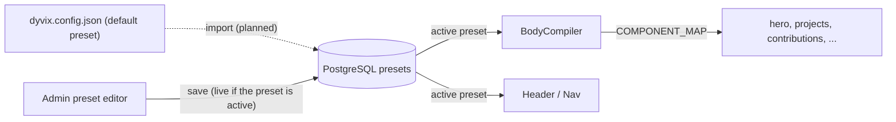

# Dyvix Portfolio Customization & Architecture Guide

This guide explains how to manage your portfolio content, how the JSON configuration works, how to add themes, and how to add your own React components.

## **Contents**

1. [Managing your portfolio](#1-managing-your-portfolio)

2. [How the configuration works](#2-how-the-configuration-works)

3. [Build your own themes](#3-build-your-own-themes)

4. [Add new components](#4-add-new-components)

---

## 1. Managing Your Portfolio

There are two ways to manage your content.

### Option A: Edit the default JSON file

[`dyvix.config.json`](https://github.com/younisdev/dyvix-portfolio/blob/main/dyvix.config.json) is the default configuration, filled with placeholder content. Edit your details, projects and social links, then load it into the database. (database loading coming soon)

### Option B: Use the admin dashboard

Make live changes without touching code or redeploying:

1. **Sign in.** Open `/admin` on your local or live deployment and sign in with the owner account, the first account you register becomes the owner. After that, only the owner can create new accounts.
2. **Edit live.** Use the preset editor to add, change or remove sections and projects. A live preview shows your changes as you make them.

3. **Keep versions.** Save several presets (layouts, themes, content snapshots), then click **Set Active** to make one of them the live site.

> **Note:** `JWT_SECRET` signs your session cookie. It isn't a login credential, and it must never be shared or committed.

---

## 2. How the Configuration Works

The default file seeds your first preset. After that, presets stored in the database are the source of truth, and the active one is what visitors see.



### The schema

[`definitions.json`](https://github.com/younisdev/dyvix-portfolio/blob/main/registery/admin/definitions.json) defines which fields exist and what type each one is. The preset editor builds its form from this file, so changing the schema changes the editor.

| Type string      | Editor control                             |
| ---------------- | ------------------------------------------ |
| `string`         | Text input                                 |
| `number`         | Number input                               |
| `color`          | Color picker                               |
| `theme`          | Theme dropdown                             |
| `Array<{ ... }>` | List editor: add, remove and reorder items |
| `"a" \| "b"`     | Dropdown (inside list items)               |
| Nested object    | Grouped section                            |

Append `?` to a key (`active?: boolean`) to make it optional (aren't supported yet.).

### Variables

You can use variables such as `${name}` inside string values, you can define a variable which includes any attribute inside the config file.

---

## 3. Build Your Own Themes

Themes are registered per component in the [`registery`](https://github.com/younisdev/dyvix-portfolio/blob/main/registery) folder.

1. Open the theme file for the component you want to theme (for example the nav theme file).

2. Add an entry with a unique `theme` name. Entries are `{ theme, properties }` objects, and the properties become the component's style overrides (CSS variables). Copy an existing entry from the same file and change the values:

```jsonc
{
"theme": "ember",
"properties": {
  "...": // copy the property keys from an existing theme in this file
}
}
```

3. Make the theme selectable in the editor: open [`DefinitionCompiler.tsx`](https://github.com/younisdev/dyvix-portfolio/blob/main/src/components/admin/config/preset/DefinitionCompiler.tsx), search for `THEME_OPTIONS`, and add your theme name. Skip this step and the theme will exist but won't appear in the editor.

---

## 4. Add New Components

Each section's `type` is looked up in `COMPONENT_MAP`, so adding a section takes four steps and no changes to the rendering pipeline. The example below adds a `testimonials` section.

> Use the same lowercase name in all four places (map key, schema key, `type`, props interface). A mismatch means the section silently renders nothing.

### 1. Build the component

Create it inside [`src/components/BodyComponents`](https://github.com/younisdev/dyvix-portfolio/blob/main/src/components/BodyComponents). It must be the **default export**, because it's loaded with `React.lazy`.

```tsx
export default function Testimonials({
  data,
  globalForegroundColor,
}: TestimonialsProps) {
  const color = data.foregroundColor ?? globalForegroundColor ?? "#f8fafc";

  return (
    <section id={data.id} style={{ color }}>
      {data.quotes.map((q, i) => (
        <blockquote key={i}>
          {q.quote} <cite>{q.author}</cite>
        </blockquote>
      ))}
    </section>
  );
}
```

### 2. Register it

Map the component in [`BodyCompiler.tsx`](https://github.com/younisdev/dyvix-portfolio/blob/main/src/components/BodyCompiler.tsx):

```tsx
const COMPONENT_MAP: Record<
  string,
  React.LazyExoticComponent<React.ComponentType<any>>
> = {
  hero: lazy(() => import("./BodyComponents/hero")),
  projects: lazy(() => import("./BodyComponents/projects")),
  contributions: lazy(() => import("./BodyComponents/contributions")),
  testimonials: lazy(() => import("./BodyComponents/testimonials")),
};
```

### 3. Define the schema

Add an entry under `body.sections` in [`definitions.json`](https://github.com/younisdev/dyvix-portfolio/blob/main/registery/admin/definitions.json). The `hero`, `projects` and `contributions` entries in that file are good models:

```json
"testimonials": {
"type": "testimonials",
"id": "string",
"foregroundColor": "color",
"quotes": "Array<{ quote: string, author: string }>"
}
```

### 4. Type the props

```tsx
interface TestimonialsProps {
  data: {
    type: "testimonials";
    id?: string;
    foregroundColor?: string;
    quotes: { quote: string; author: string }[];
  };
  globalForegroundColor?: string; // provided by the compiler
  theme?: string; // provided by the compiler
  tl?: gsap.core.Timeline | null; // the page's intro timeline; add your entrance animation to it, or ignore it
  disableAnimation?: boolean; // set by the editor preview; skip entrance animations when true
}
```

Your new section now appears in the preset editor. Add it to a preset and it renders on the page.

---

## Need Help?

Found a bug or have a question? Open an issue or a pull request on [GitHub](https://github.com/younisdev/dyvix-portfolio). Contributions and suggestions are welcome.
